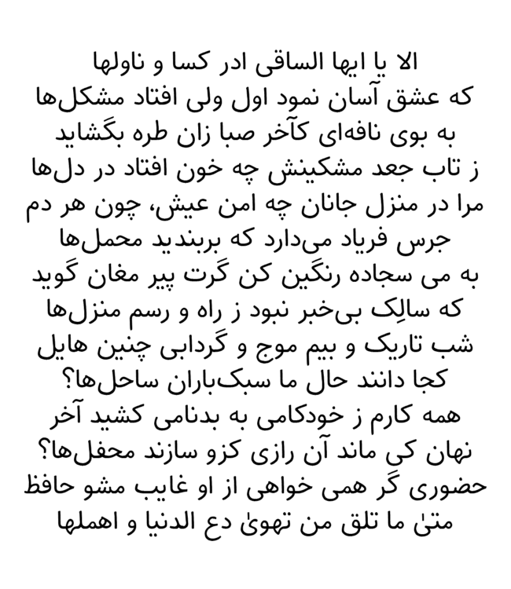

# Tavana

A handwritten Perso-Arabic font.

یک فونت فارسی دست‌نویس.

## Installation

Refer to the [releases](https://github.com/TDCMC/Farid/releases) section for download links.

برای دانلود به بخش [releases](https://github.com/TDCMC/Farid/releases) مراجعه کنید.

## Copying

This project is released under the [SIL Open Font License version 1.1](https://openfontlicense.org/documents/OFL.txt).

این پروژه تحت مجوز [SIL Open Font License version 1.1](https://openfontlicense.org/documents/OFL.txt) می‌باشد.